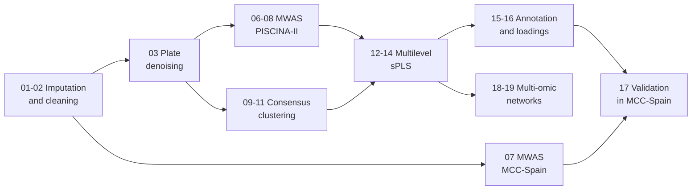

# Multi-omic signatures of exposure to water disinfection by-products

Analysis code for:

> Cheng SL, Keski-Rahkonen P, Chatziioannou AC, *et al.* (2026). **Exploring molecular signatures of exposure to water disinfection by-products: A multi-omic analysis across multiple exposure routes.** *Environment International*, 215, 110442. [doi:10.1016/j.envint.2026.110442](https://doi.org/10.1016/j.envint.2026.110442)

## Overview

Trihalomethanes (THMs) are disinfection by-products (DBPs) formed when chlorine reacts with organic matter in water, and they have been linked to bladder and colorectal cancer. This project looks for molecular signatures of THM exposure in two studies with very different exposure routes and levels:

- **PISCINA-II (discovery):** 58 healthy adults swam for 40 minutes in a chlorinated indoor pool. Serum metabolomics (UHPLC-QTOF-MS), serum immune markers and THMs in exhaled breath were measured before and after swimming.
- **MCC-Spain (validation):** 293 cancer-free controls from a multicentre case-control study, with residential tap-water THM exposure estimates and serum metabolomics.

The analysis combines univariate and multivariate methods:

1. **Pre-processing:** missingness filtering, QRILC imputation of left-censored values, and removal of plate effects with linear mixed models.
2. **Metabolome-wide association study (MWAS):** multivariate normal models for repeated measures (generalised least squares with an unstructured within-subject correlation), one model per feature and THM. Features are significant after Bonferroni correction.
3. **Stability-calibrated consensus clustering** ([`sharp`](https://cran.r-project.org/package=sharp)) of correlated features, which typically come from adducts and fragments of the same compound. Each cluster is summarised by its first principal component.
4. **Multilevel sparse PLS** ([`mixOmics`](https://mixomics.org)) with the four THMs as predictors and the metabolic clusters as outcomes. The model is calibrated on cross-validated Q² and on out-of-sample correlation between components.
5. **Stability-calibrated graphical LASSO networks** linking the selected metabolic clusters and immune markers, estimated before and after swimming.
6. **Validation in MCC-Spain:** features are matched across studies (≤ 7 ppm, ± 0.1 min) and the annotated compounds are tested with linear regression.

**Main findings:** 188 metabolic features were associated with at least one THM. sPLS selected 21 clusters (72 features), from which 12 compounds were identified. L-kynurenine, LysoPE (20:4), piperine and cortisone were also identified in MCC-Spain despite much lower exposure contrasts.

## Workflow



## Repository structure

| Folder | Script | Description |
|---|---|---|
| `01-Preprocessing` | `01-Imputation.R` | PISCINA-II: drop features with > 60% missing values, log2-transform, QRILC imputation |
| | `02-Data_cleaning.R` | Clean and align metabolomics, covariates, exposures, transcriptomics and proteomics (PISCINA-II); clean and impute MCC-Spain data |
| | `03-Denoising.R` | Remove plate effects (random intercept per plate) |
| | `04-EDA.R` | Descriptive tables (Table 1, exposure levels), exposure plots, correlation heatmaps |
| | `05-Reprocessing.R` | Compare the original and reprocessed metabolomics feature sets |
| `02-Univariate` | `06-MWAS_PISCINA.R` | MWAS using multivariate normal models |
| | `07-MWAS_MCC.R` | MWAS in MCC-Spain (linear models; sensitivity analyses for WCRF score and area) |
| | `08-Analysis_univariate.R` | Bonferroni-significant features; Manhattan, volcano and UpSet plots |
| `03-Clustering` | `09-Clustering_metab_hpc.R` | Consensus clustering for one candidate number of clusters (HPC array job) |
| | `run_consensus_clustering.sh` | PBS array script for `09` (300 jobs) |
| | `10-Merge_clustering_results.R` | Combine the jobs and select the most stable number of clusters |
| | `11-Clustering_results.R` | Summarise clusters by PC1 (centroids), cluster statistics and figures |
| `04-sPLS` | `12-sPLS_perf_centroid.R` | sPLS calibration on cross-validated Q² / MSEP (parallel) |
| | `13-sPLS_cor_centroid.R` | sPLS calibration on out-of-sample correlation (parallel) |
| | `spls.sh` | PBS script for `12` and `13` |
| | `14-sPLS_Results.R` | Select and fit the final sPLS models, evaluate performance, calibration figures |
| | `15-Merge_Annotation.R` | Attach compound annotation to the selected clusters |
| | `16-sPLS_loading_plot_xy.R` | Loadings, VIP, explained variance; sPLS vs. MWAS; circular plot |
| | `17-Compare_sign_annotation.R` | Match features to MCC-Spain, detection rates, validation tables |
| `05-Graph` | `18-Stability_Graphs.R` | Multi-block conditional independence networks before and after swimming |
| | `19-Plot_Graphs.R` | Network calibration plots and network figure |
| | `functions.R` | Helper functions (mixed models, MVN models, cluster summaries, sPLS calibration, feature matching) |

## Data

The individual-level data are **not included** in this repository. As stated in the paper, data will be made available upon request.

The scripts expect this project layout. This repository is the `Scripts/` folder:

```
<project root>/
├── Data/
│   ├── New dataset/     PISCINA-II metabolomics, covariates, exposures, sample worklist
│   ├── Old dataset/     original PISCINA-II metabolomics processing
│   ├── Transcripts/     PISCINA-II transcriptomics
│   ├── Prot/Data/       PISCINA-II immune markers
│   ├── MCC/             MCC-Spain covariates, exposures and metabolomics
│   └── Cleaned_Data/    created by 01-Imputation.R and 02-Data_cleaning.R
├── Annotation/          feature annotation table
├── Results/             created by the scripts
└── Scripts/             this repository
```

## Running the analysis

All paths are relative to the project root. Run the scripts in numerical order from the project root:

```bash
cd /path/to/project
Rscript Scripts/01-Preprocessing/01-Imputation.R
```

To run them from somewhere else, set the `PISCINA_DIR` environment variable to the project root:

```bash
export PISCINA_DIR=/path/to/project
```

Three steps are computationally intensive and were run on the Imperial College London HPC cluster (PBS):

```bash
qsub Scripts/03-Clustering/run_consensus_clustering.sh
qsub -v SCRIPT=Scripts/04-sPLS/12-sPLS_perf_centroid.R Scripts/04-sPLS/spls.sh
qsub -v SCRIPT=Scripts/04-sPLS/13-sPLS_cor_centroid.R Scripts/04-sPLS/spls.sh
```

Most scripts have `write.res`, `write.tab` and `write.fig` flags at the top. They are `FALSE` by default, so set them to `TRUE` to save results, tables and figures.

## Requirements

The analyses were run with R 4.1.3. Required packages:

- **CRAN:** `dplyr`, `tidyr`, `stringr`, `tibble`, `ggplot2`, `patchwork`, `RColorBrewer`, `pheatmap`, `gridExtra`, `gt`, `gtsummary`, `ComplexUpset`, `readxl`, `foreign`, `imputeLCMD`, `lme4`, `nlme`, `doBy`, `FactoMineR`, `sharp`, `igraph`, `circlize`
- **Bioconductor:** `mixOmics`, `ComplexHeatmap`; `pcaMethods` and `impute` are needed by `imputeLCMD`

```r
install.packages("BiocManager")
BiocManager::install(c("mixOmics", "ComplexHeatmap", "pcaMethods", "impute"))
install.packages(c(
  "dplyr", "tidyr", "stringr", "tibble", "ggplot2", "patchwork", "RColorBrewer",
  "pheatmap", "gridExtra", "gt", "gtsummary", "ComplexUpset", "readxl", "foreign",
  "imputeLCMD", "lme4", "nlme", "doBy", "FactoMineR", "sharp", "igraph", "circlize"
))
```

## Citation

If you use this code, please cite the paper:

```bibtex
@article{cheng2026dbp,
  title   = {Exploring molecular signatures of exposure to water disinfection by-products:
             A multi-omic analysis across multiple exposure routes},
  author  = {Cheng, Sibo Lucas and Keski-Rahkonen, Pekka and Chatziioannou, Anastasia Chrysovalantou
             and Vuckovic, Dragana and Barron, Leon P. and Dehghan, Abbas and Vlaanderen, Jelle
             and Portengen, L{\"u}tzen and Jim{\'e}nez Zabala, Ana and Guevara, Marcela
             and Gomez Acebo, Ines and Molina de la Torre, Antonio Jos{\'e} and Scalbert, Augustin
             and Vineis, Paolo and Elliott, Paul and Vermeulen, Roel and Kogevinas, Manolis
             and Villanueva, Cristina M. and Dagnino, Sonia and Chadeau-Hyam, Marc},
  journal = {Environment International},
  volume  = {215},
  pages   = {110442},
  year    = {2026},
  doi     = {10.1016/j.envint.2026.110442}
}
```

## Author

Sibo Lucas Cheng ([ORCID 0009-0009-8930-6148](https://orcid.org/0009-0009-8930-6148)), Department of Epidemiology and Biostatistics, School of Public Health, Imperial College London.
